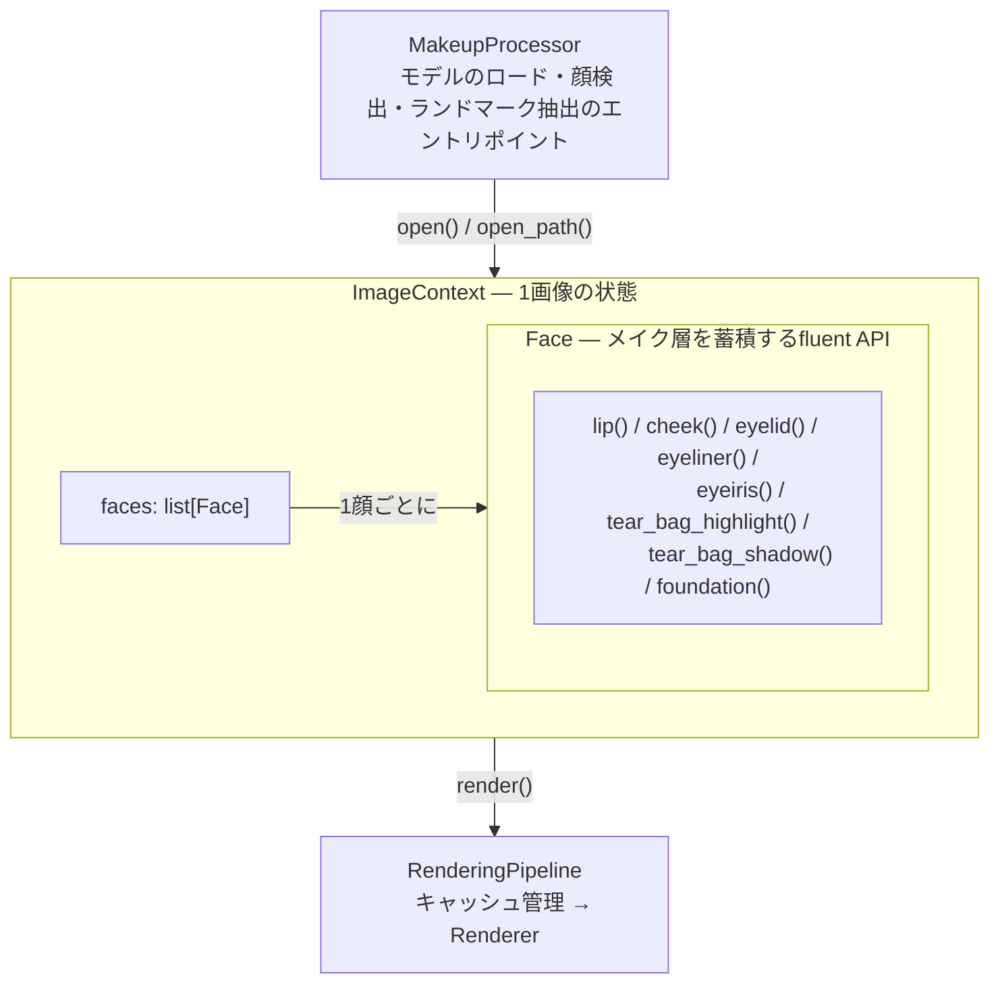

# アーキテクチャ

本ドキュメントは `face_makeup` の内部設計をレイヤごとに説明します。ライブラリ利用者向けの API リファレンスは [quick-reference.md](quick-reference.md) を参照してください。

## レイヤ構造

```
┌─────────────────────────────────────────────────┐
│  MakeupProcessor  ──  モデルロード・顔検出      │
│  (1インスタンスで複数画像を逐次処理可能)          │
├─────────────────────────────────────────────────┤
│  ImageContext  ──  1画像の状態とFaceリスト       │
├─────────────────────────────────────────────────┤
│  Face  ──  メイク操作のfluent API (ビルダー)     │
├─────────────────────────────────────────────────┤
│  RenderingPipeline  ──  キャッシュ管理           │
├─────────────────────────────────────────────────┤
│  Renderer  ──  2フェーズレンダリング             │
├─────────────────────────────────────────────────┤
│  MaskStrategy / BlendStrategy / MakeupPass       │
│  (抽象)                                          │
├─────────────────────────────────────────────────┤
│  core/passes/  ──  具象実装                      │
├─────────────────────────────────────────────────┤
│  core/blend/  ──  leaf層 (cv2/numpyのみ)         │
├─────────────────────────────────────────────────┤
│  core/types.py  ──  パラメータ定義               │
└─────────────────────────────────────────────────┘
```



## 1. Processor 層 — `MakeupProcessor`

`MakeupProcessor` は MediaPipe モデル（顔検出・ランドマーク・髪セグメンテーション）の読み込みとライフサイクルを管理するエントリポイントです。1インスタンスで複数画像を逐次処理できますが、スレッドセーフではないため、並行処理にはインスタンスを分けてください。

- `open(image: np.ndarray)` — ndarray から `ImageContext` を生成
- `open_path(path: str)` — ファイルパスから画像を読み込み `ImageContext` を生成
- `close()` — 全リソースを解放（コンテキストマネージャ対応）

髪セグメンテーションモデルは初回利用時に自動ダウンロードされ、SHA256 チェックサムで検証されます。モデルが見つからない・ダウンロード失敗時は髪除外がスキップされ、他のメイク処理は継続します。

## 2. Context 層 — `ImageContext`

1画像の状態（元画像・検出済み `Face` リスト）を保持します。`Face` にメイク操作が追加されると、`change_callback` 経由で `RenderingPipeline` のキャッシュが無効化されます。

`render()` / `save()` / `show()` は `RenderingPipeline` に委譲します。

## 3. Face 層 — `Face`

1顔分のメイク操作をメソッドチェーンで蓄積するビルダーです。各メソッドは対応する `PartParams` のインスタンスを生成し、`MakeupPass` を内部リストに追加します。レンダリングは行いません。

```python
ctx.faces[0] \
    .foundation(color=(255, 220, 200), opacity=0.3) \
    .cheek(color=(255, 180, 180), opacity=0.3) \
    .lip(color=(255, 100, 100), opacity=0.5)
```

利用可能なメソッド:

| メソッド | 対応する Pass | PartParams |
|---|---|---|
| `lip()` | `LipsPass` | `LipsParams` |
| `cheek()` | `CheekPass` | `CheekParams` |
| `eyelid()` | `EyeShadowPass` | `EyeShadowParams` |
| `eyeliner()` | `EyelinerPass` | `EyeLinerParams` |
| `eyeiris()` | `EyeIrisPass` | `EyeIrisParams` |
| `tear_bag_highlight()` | `TearBagHighlightPass` | `TearBagHighlightParams` |
| `tear_bag_shadow()` | `TearBagShadowPass` | `TearBagShadowParams` |
| `foundation()` | `FoundationPass` | `FoundationParams` |

サイド指定があるメソッド（`cheek()`、`eyelid()`、`eyeliner()`、`eyeiris()`、`tear_bag_highlight()`、`tear_bag_shadow()`）は `side='both'` の場合、左右それぞれ1つずつ、計2つの `MakeupPass` を追加します。

## 4. Pipeline 層 — `RenderingPipeline`

`RenderingPipeline` はレンダリング結果のキャッシュを管理します。キャッシュは `WeakKeyDictionary` で `ImageContext` をキーとして保持され、`ImageContext` が GC されると自動解放されます。

`Face` にメイクが追加されるたびに `ImageContext._invalidate_cache()` が呼ばれ、該当コンテキストのキャッシュエントリが削除されます。

`render()` 時にキャッシュが存在すればそれを返し、なければ `Renderer` を生成して新たに描画し、結果をキャッシュします。

## 5. Renderer 層 — 2フェーズレンダリング

`Renderer.render_face()` は「マスク生成 → 合成」を2フェーズに分離します。これは、フェザー（エッジぼかし）計算をマスクの完全なジオメトリに対して行い、除外による「穴」が距離計算を歪めないようにするためです。

### Phase 0 — まつ毛ラインの補正

Phase 1 の前に、顔ごとに1回だけまつ毛ラインのランドマーク（1401〜1707）をまつ毛ライン上へ補正します（`LashLineCorrector`。詳細は後述の「まつ毛ラインの補正」を参照）。補正後の座標は、以降のすべてのパスの `generate()` と clip / exclusion に渡します。補正は、`uses_lash_line` が `True` の `MaskStrategy` か、clip / exclusion にまつ毛ラインのランドマークを含むパスがあるときだけ行います。

### Phase 1 — マスク生成とゲーティング

各 `MakeupPass` について:

1. `mask_strategy.generate()` — 形状＋フェザー込みの最終ソフトマスク（float32, 0..1）を生成
2. **clip（AND）** — `clip_landmarks` から `_build_landmark_group_mask()` で領域を計算し、`soft *= clip_mask`。例: カラコンは目の開口部輪郭でクリップ
3. **除外（AND NOT）** — `exclusion_landmarks` から `soft *= (1 - lm_exclusion)`。例: ファンデーションから目・唇を除外
4. **髪除外（AND NOT）** — `HairSegmenter` の結果をフェザリングした `hair_soft` を全パス共通で減算

マスクは `mask_cache: dict[int, np.ndarray]` に `id(pass_)` をキーとして保存されます。`pass_type` ではなく `id(pass_)` を使うのは、同じ `pass_type` を持つパスを複数回重ねるケース（例: 涙袋ハイライトをサイズ違いで2層重ねる）で上書きされないようにするためです。

### Phase 2 — 優先度順ブレンド

`priority` の昇順（小さい値が先＝下のレイヤー）で `blend_strategy.apply()` を呼び出し、画像に色を合成します。

### 除外・クリップの責務分担

`MaskStrategy` は形状定義に専念し、`clip_landmarks` / `exclusion_landmarks` による除外ロジックを持ちません。これにより、フェザー計算がマスクの完全なジオメトリに対して行われ、除外による境界形状の歪みを防ぎます。

## 6. Strategy 層 — `MaskStrategy` / `BlendStrategy` / `MakeupPass`

`core/pipeline.py` が定義する抽象です。

| 抽象 | 役割 | 契約 |
|---|---|---|
| `MaskStrategy` | 形状定義。ランドマーク座標からソフトマスクを生成 | `generate()` はフェザー込みの最終マスク（float32, 0..1）を返す。まつ毛ラインのランドマークを使う場合はクラス属性 `uses_lash_line = True` を宣言する |
| `BlendStrategy` | 色の合成。マスクと `PartParams` から画像に色を乗せる | `apply()` は新しい (H, W, 3) uint8 配列を返す（入力を変更しない） |
| `MakeupPass` | 上記2つ＋パラメータ＋優先度＋clip/exclusion 宣言をまとめた実行単位 | `pass_type`, `priority`, `params`, `mask_strategy`, `blend_strategy`, `exclusion_landmarks`, `clip_landmarks` |

## 7. Pass 層 — `core/passes/`

各ファイルが1メイク効果の具象実装（`MaskStrategy` + `BlendStrategy` + `MakeupPass`）を提供します。ただし `tearbag.py` はハイライト用とシャドウ用の2つの `MakeupPass` を含みます。

| ファイル | パス | マスク | ブレンド |
|---|---|---|---|
| `lips.py` | `LipsPass` | 唇輪郭ポリゴン | HSV マット |
| `cheek.py` | `CheekPass` | 楕円（接平面射影＋二次曲面フィット） | HSV マット |
| `eyeshadow.py` | `EyeShadowPass` | まぶた帯状ポリゴン | HSV マット |
| `eyeliner.py` | `EyelinerPass` | 補正後のまつ毛ラインに沿ったポリライン | HSV マット |
| `eyeiris.py` | `EyeIrisPass` | 虹彩円形マスク | 色相シフト / HSV 置換 |
| `tearbag.py` | `TearBagHighlightPass` | 涙袋ポリゴン | スクリーン |
| `tearbag.py` | `TearBagShadowPass` | 涙袋下部ポリライン | HSV マット |
| `foundation.py` | `FoundationPass` | 顔楕円マスク（目・唇除外） | 線形（lerp） |

### まつ毛ラインの補正

MediaPipe の目の輪郭は、見た目のまつ毛ラインより少し内側にあります。`core/landmark_correction.py` の `LashLineCorrector` は、renderer の Phase 0 でまつ毛ラインのランドマーク（1401〜1407・1501〜1507・1601〜1607・1701〜1707。コード上の名称は edge）を実際のまつ毛ライン上へ移します。補正後の座標は全パスで共有するので、アイライナー、アイシャドウ（`EYELID_*_INDICES`）、涙袋（`TEAR_BAG_ROOT_*`）、およびファンデーションの目元の除外範囲が同じまつ毛ラインを使います。これらの定数では、まつ毛ライン部分の点に MediaPipe の点ではなくまつ毛ラインのランドマークの ID を使います。上下のラインで重複する1507/1707は、どちらのモードでも下まぶたの点として1回だけ補正します（`core/lash_line_edges.py`）。

モードは `ProcessorConfig.landmark_correction` で選択します（`'ml'` / `'rule'`、デフォルト `'ml'`）。補正処理のインスタンスは初回の補正時に生成し、`RenderingPipeline` が全レンダリングで共有します。

- `'ml'` — 機械学習補正。まつ毛ライン補正モデルがインストールされていない、読み込めない、または入出力契約に合わないときは、最初の補正時に例外を送出する。ルールベース補正へのフォールバックはしない。描画時にモデルをダウンロードすることはない。
- `'rule'` — ルールベース補正。モデルを読み込まない。

`debug=True` のときは、どちらの補正処理も描画時の `correct_points` の結果をキャッシュから返すので、検出や推論をやり直しません。ルールベース補正は点ごとに輝度・微分のグラフを、機械学習補正は目ごとに P/Q/R を重ねた拡大画像（`core/eyeliner_ml_debug.py`）を保存します。

- `EyelinerCorrector`（`core/eyeliner_corrector.py`）— ルールベース補正。P→Q 方向の画素輝度をサンプリングし、2階微分ゼロ交差（暗→明遷移）をアイライナー縁として検出。
- `EyelinerMLCorrector`（`core/eyeliner_ml_corrector.py`）— [EyeContourRefiner](https://github.com/kurumikurukuri/EyeContourRefiner) のまつ毛ライン補正モデル（dual-branch ONNX、CPU、onnxruntime）で、まつ毛ラインの各ランドマークについて、補正点を `R = t*P + (1-t)*Q` で表したときの `t` を予測。P は目の開口部輪郭上のランドマーク、Q はそこから目の外側へ離れたランドマーク。
  - `core/eyeliner_patch.py` — 学習時と数値的に同一のパッチ切り出し（上流 `patch_utils.py` の移植。変更すると、エラーにならないまま予測精度が落ちる）。
  - `core/eyeliner_model.py` — まつ毛ライン補正モデルの取得・読み込みと入出力契約の検証。モデルは本リポジトリに同梱せず、`pip install` 時（`setup.py` の `build_py` フック）と `git pull` 後（`.githooks/`）に EyeContourRefiner `main` の最新版を取得する。標準ライブラリだけで import できるので、パッケージの外（ビルド時・フック）からも直接実行できる。

## 8. Blend 層 — `core/blend/`

`core/blend/` は cv2/numpy のみに依存する leaf 層です。`passes`/`pipeline`/`types` 等他レイヤを import しません。

| ファイル | 内容 |
|---|---|
| `blend_utils.py` | `blend_matte()`（HSV）、`blend_linear()`（lerp）、`blend_screen()`、`blend_hue_shift()`、`soften_mask()`、`feather_px_from_softness()` |
| `glitter.py` | Poisson-disk 粒子生成、光彩（iridescence）計算、ブルーム後処理 |

すべてのブレンド関数は新しい `ndarray` を返し、入力を変更しません。

## 9. Types 層 — `core/types.py`

`PartParams` を基底とする dataclass 群です。各サブクラスは `__post_init__` で範囲バリデーションを行い、`_FEATHER_SCALE` / `_SOFTEN_FLOOR` の ClassVar でパーツごとのフェザー調整値を上書きします。

```
PartParams
├── FoundationParams
├── LipsParams
├── CheekParams       (center, radius)
├── EyeShadowParams   (size, glitter, seed)
├── EyeLinerParams    (thickness)
├── EyeIrisParams     (hue_shift)
├── TearBagHighlightParams  (size, glitter, seed)
└── TearBagShadowParams     (thickness, size)
```

## 新規メイク効果の追加方法

`core/passes/` に1ファイル追加するだけで完結します:

1. `MaskStrategy` サブクラス — ランドマークから形状を作り、フェザーを焼き込んだソフトマスクを返す
2. `BlendStrategy` サブクラス — マスクと `PartParams` から色を合成する
3. `MakeupPass` サブクラス — `pass_type`, `priority`, 必要なら `exclusion_landmarks` / `clip_landmarks` を設定

パラメータが必要な場合は `core/types.py` に `PartParams` を継承した dataclass を追加し、`Face` クラスにビルダーメソッドを追加します。
